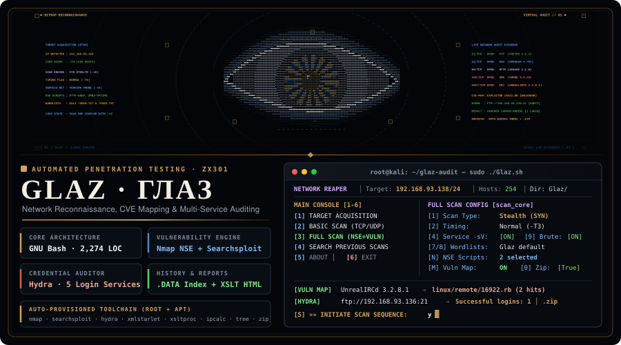
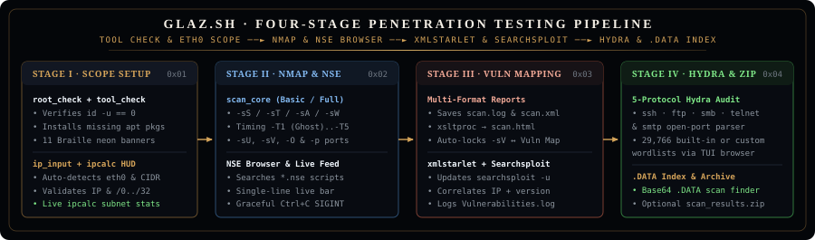
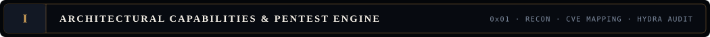
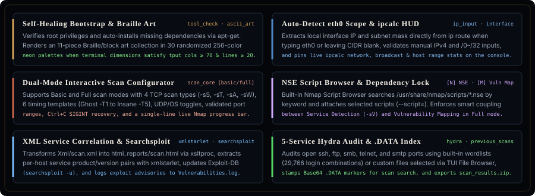
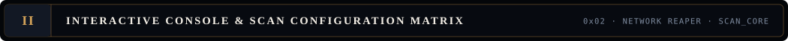
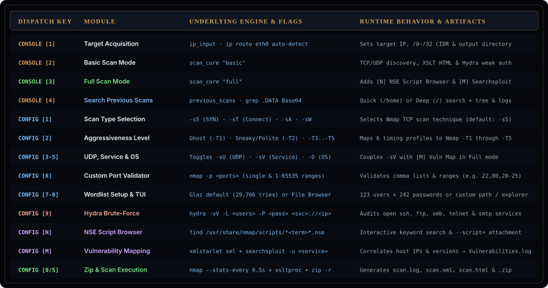
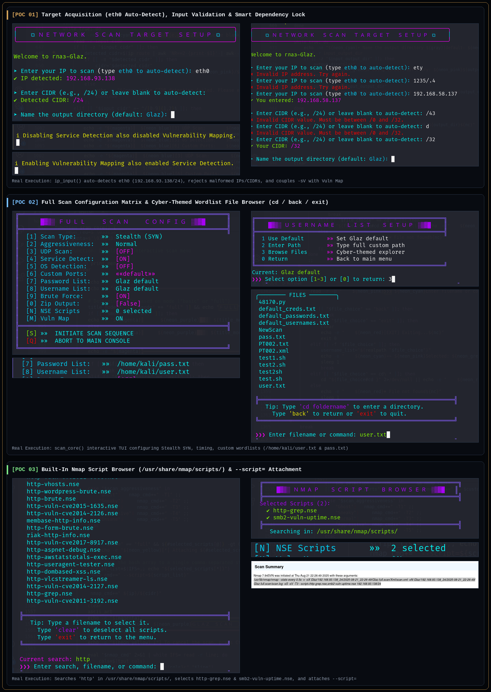
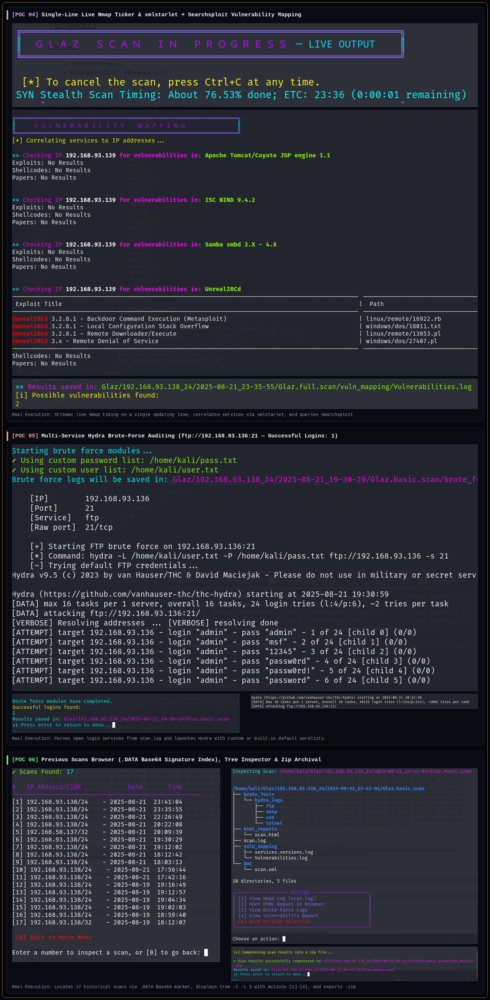
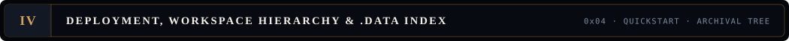
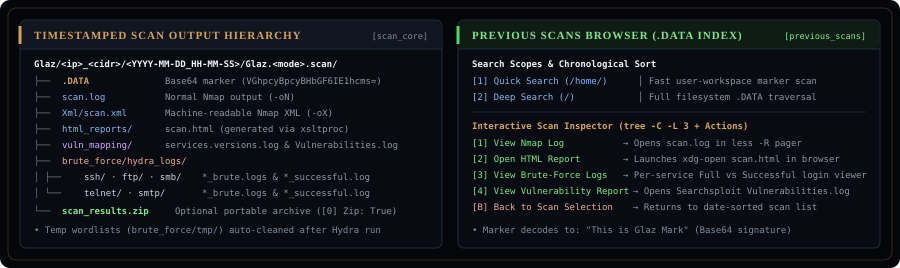

<div align="center">



<br/>

[](Glaz.sh)
[](Glaz.sh)
[](Glaz.sh)
[-F59E0B?style=for-the-badge&logo=read-the-docs&logoColor=white&labelColor=090D14)](docs/Glaz_Portfolio.pdf)
[-3FB950?style=for-the-badge&logo=files&logoColor=white&labelColor=090D14)](Glaz.pdf)

<br/>



<br/><br/>





<br/><br/>





<br/><br/>




<br/>



<br/><br/>



</div>

```bash
git clone https://github.com/ArtistS24/glaz-audit.git
cd glaz-audit
chmod +x Glaz.sh
sudo ./Glaz.sh
```

<div align="center">



<br/><br/>

[](https://github.com/nmap/nmap)
[](https://gitlab.com/kalilinux/packages/exploitdb)
[](https://github.com/vanhauser-thc/thc-hydra)
[](https://xmlstar.sourceforge.net/)
[](https://gitlab.gnome.org/GNOME/libxslt)

</div>
